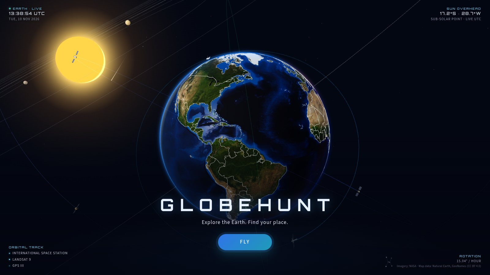
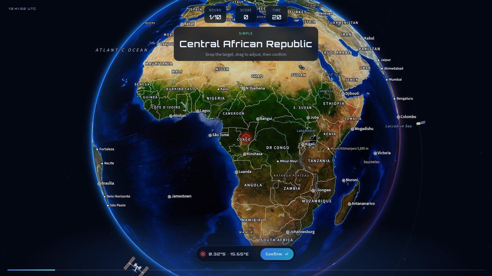
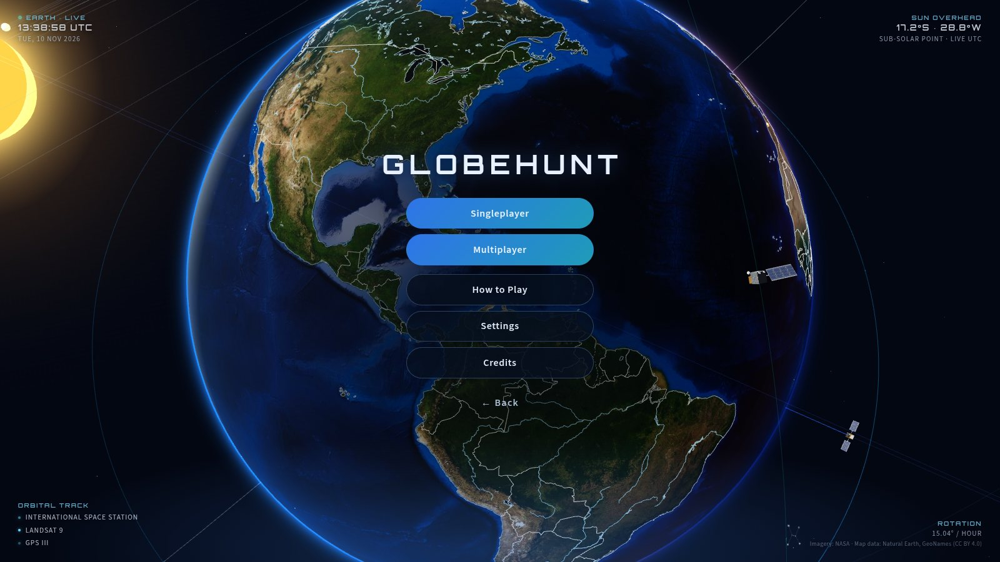
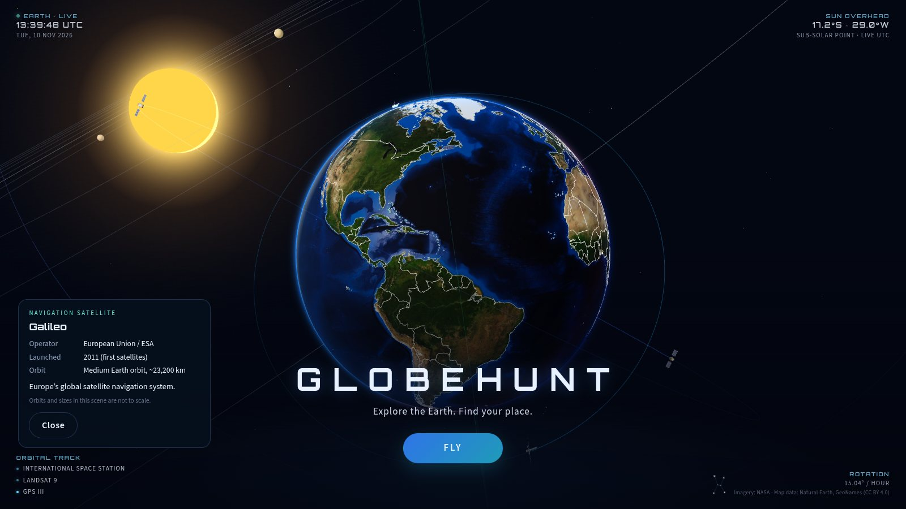
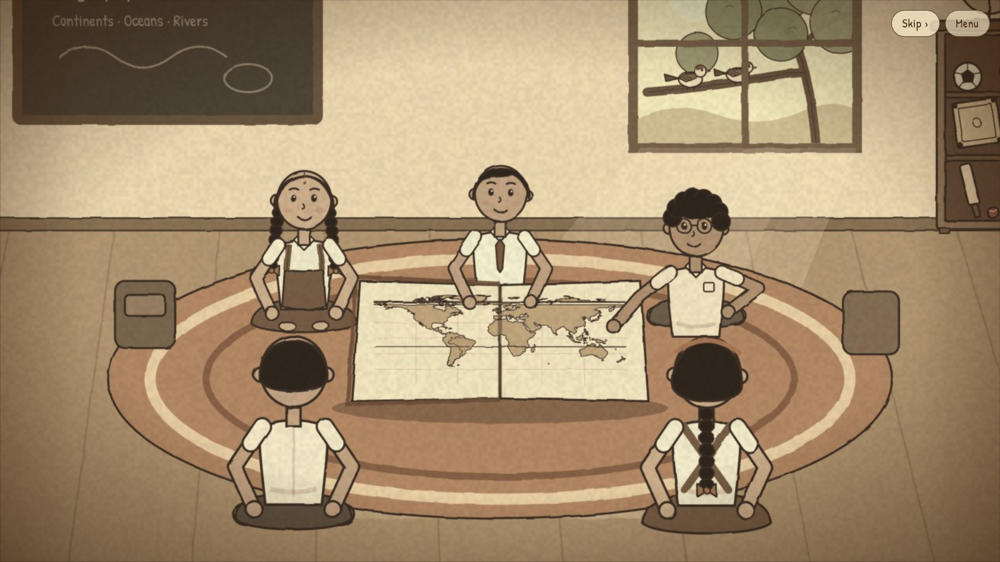

  <picture>
    <source media="(prefers-color-scheme: dark)" srcset=".github/assets/logo-dark.svg">
    <source media="(prefers-color-scheme: light)" srcset=".github/assets/logo-light.svg">
    
  </picture>

  <strong>Explore the Earth. Find your place.</strong> 
  A geography game played on a living 3D planet, alone or with friends.

  
  
  
  

  

---

## The game

GLOBEHUNT names a place and gives you a few seconds to find it. Spin the globe, zoom
in, drop your target on it and confirm. Land in the right spot and you score; the
faster you are, the more points you earn. Miss and the round is gone.

It starts easy with countries, then climbs through major cities and small towns to
the hardest tier: rivers, mountain peaks, lakes, straits and islands.

  

## How a round works

1. **A place appears** at the top of the screen, with the clock already running.
2. **Fly to it.** Drag to spin the Earth, scroll or pinch to zoom. Borders, cities and
   natural features come into focus as you get closer.
3. **Drop your target**, nudge it into place, and confirm.
4. **Score.** Up to 1,000 points for an instant answer, multiplied by how hard the
   place is. Wrong answers never score.

## Difficulty

| Level | What you hunt | Places | Bonus |
| --- | --- | ---: | ---: |
| **Simple** | Countries | 172 | ×1.0 |
| **Medium** | Major cities | 769 | ×1.2 |
| **Hard** | Smaller cities and towns | 3,830 | ×1.4 |
| **Expert** | Rivers, mountains, lakes, straits and islands | 722 | up to ×1.7 |

Each match can run from 1 to 50 rounds, with anywhere from 5 seconds to 5 minutes per
round. Map labels can be switched off for a real challenge.

## Play together

Open a room, share the 4-digit code or invite link, and up to **8 players** race to the
same places at the same moment. Everyone sees the same round, the same clock and a
live scoreboard. Answers are checked by the game server, so the scoreboard stays fair.
If your connection drops mid-match, you rejoin straight into your seat.

## A living planet

The globe is not a static map. Everything around it follows the real sky:

- **Real daylight.** The Sun sits where it is right now, so day, night and twilight
  sweep across the Earth as you play.
- **Satellites in orbit.** The ISS, Hubble, Landsat 9, Sentinel-2A, GPS III, Galileo
  and GOES-16 circle the planet with their solar panels turned towards the Sun.
  Click one to learn what it does.
- **The Solar System.** Click the Sun, the Moon or any planet for a short fact card with
  real NASA imagery.
- **Constellations.** Orion, the Big Dipper, the Southern Cross and ten more hang in the
  sky above the regions of Earth they really sit over.
- **NASA Blue Marble imagery** that sharpens as you zoom in.

<table>
  <tr>
    <td width="50%"></td>
    <td width="50%"></td>
  </tr>
  <tr>
    <td align="center">Main menu</td>
    <td align="center">Click any satellite or planet to learn about it</td>
  </tr>
</table>

## How to Play, told as a story

How to Play is a short animated story set in a school classroom, where a group of
friends turn a paper world map into the game you are about to play. It is hand-drawn
in code and can be skipped at any moment.

  

## Made to feel good everywhere

- **Plays on any screen.** Mouse, trackpad and touch controls are all first-class, with
  layouts tuned for phones as well as desktops.
- **Adapts to your device.** GLOBEHUNT checks your hardware and keeps the frame rate
  smooth, quietly lowering detail on older laptops and phones.
- **Live soundtrack.** All music and sound effects are synthesised in the browser as you
  play, with no recorded audio.
- **Respects your settings.** Reduced-motion preferences are honoured, and volume,
  graphics and controls can all be tuned from Settings.

## Built with

React · TypeScript · Three.js · React Three Fiber · Socket.IO

## Credits

- Earth imagery, satellite and planet photographs: **NASA** (public domain). NASA does
  not endorse this game.
- Borders, coastlines, rivers and lakes: **Natural Earth** (public domain).
- Towns, villages and regions: **GeoNames**, licensed under
  [CC BY 4.0](https://creativecommons.org/licenses/by/4.0/).
- Fonts: Orbitron, Patrick Hand and Source Sans 3 (SIL Open Font License).

Full attributions are listed in [ATTRIBUTIONS.md](ATTRIBUTIONS.md).

   
  Made for everyone who ever spun a globe and stopped it with a finger.

